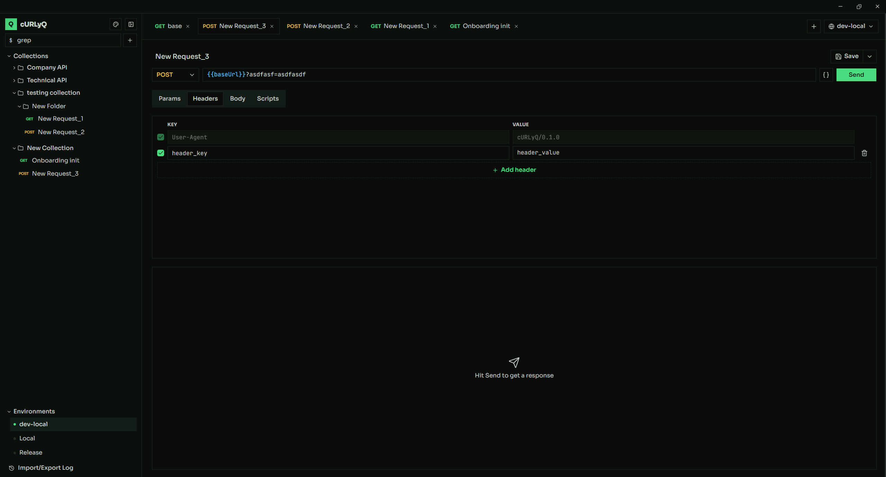
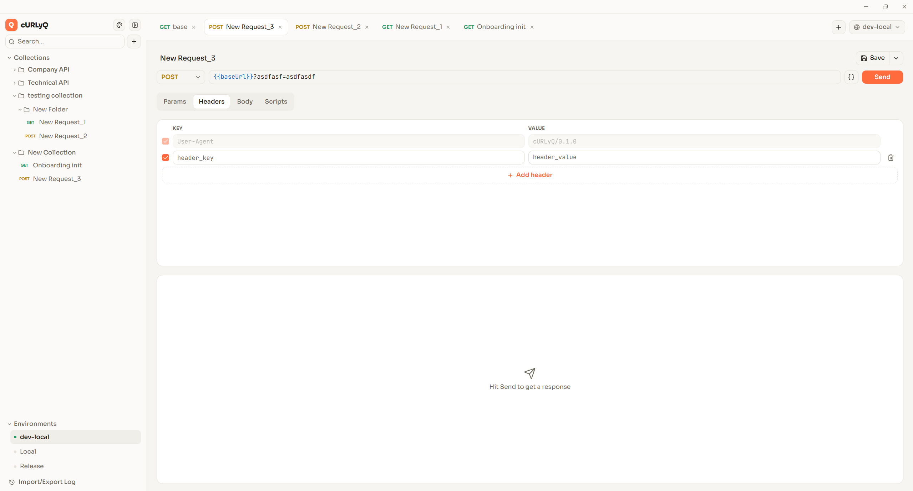

# cURLyQ

A desktop HTTP client for sending requests and inspecting responses — a Postman alternative, inspired by it. Built as a learning project for practicing Claude Code, step by step. See [`project_specs.md`](./project_specs.md) for the shipped MVP scope.

<p align="center">
  
  
</p>

## Install

Download the installer for your OS from the [latest release](https://github.com/YeaaaaH/cURLyQ/releases/latest):

| OS | File |
|---|---|
| Windows 10 (1803+) / 11 | `.msi` or `-setup.exe` |
| macOS 11+ (Apple Silicon) | `_aarch64.dmg` |
| macOS 10.13+ (Intel) | `_x64.dmg` |
| Linux (Ubuntu 22.04+ / Debian 12+) | `.deb`, `.rpm`, or `.AppImage` |

Builds aren't code-signed yet, so the OS warns on first launch: on Windows, SmartScreen → **More info** → **Run anyway**; on macOS, try to open the app once, then go to **System Settings → Privacy & Security** and click **Open Anyway**.

## Features

- **Request builder** — method, URL with live query-param sync, headers, and a raw/JSON body (auto-sets `Content-Type: application/json`; `//` and `/* */` comments allowed, and kept by **Beautify**). **Ctrl+Enter** sends from anywhere, including the body and script editors. The response shows status, time, size, headers, and a pretty-printed body.
- **Tabs** — multiple requests open at once, persisted across restarts. **Ctrl+S** saves a tab back to its collection; a dot marks tabs with unsaved changes.
- **Environments** — `{{variable}}` substitution across URL/params/headers/body. Tokens are colored resolved / unresolved / circular; hovering one shows its value, lets you edit it, or creates a missing variable. The **Variables** panel lists every variable a request uses and the exact cURL command it will send.
- **Collections** — Postman-style nested folders, drag-and-drop reordering and moving (including across collections), duplicating collections, folders, and requests, and a sidebar search across collections and environments.
- **Collection run** — run every request in a collection or folder in order. Results open in their own tab; variables set by one request's scripts are visible to the next.
- **Pre-request / post-response scripts** — sandboxed JavaScript per request that can read/write environment variables and (pre-request) override headers/body. Postman's `pm.*` API works for the supported subset. Scripts can reach the network and see every environment variable, so only run ones you trust. See [`docs/scripting.md`](./docs/scripting.md).
- **Postman import/export** — environments and collections as Postman v2.1 JSON, including scripts on export.
- **Themes** — light, dark, and terminal (a CRT-inspired palette), with a custom titlebar so the window chrome follows the theme too.

## Stack

- **Frontend**: TypeScript + React, in Tauri's native webview. Styled with Tailwind CSS v4 + shadcn/ui; drag-and-drop via `@dnd-kit`, toasts via `sonner`.
- **Backend**: Rust, exposed as Tauri commands (`#[tauri::command]`); performs the actual HTTP requests via `reqwest`.
- **Packaging**: Tauri (native binary, not Electron).

## Development

Prerequisites: Node.js, Rust (via [rustup](https://rustup.rs/)), and the [Tauri system dependencies](https://v2.tauri.app/start/prerequisites/) for your OS — on Windows, the MSVC C++ Build Tools.

How the app is put together — the request flow, where state lives, and the Rust ↔ TypeScript contract — is in [`docs/architecture.md`](./docs/architecture.md). Releases are cut as described in [`docs/releasing.md`](./docs/releasing.md).

```sh
npm install
npm run tauri dev    # run the app with hot reload
npm run tauri build  # build a release binary
```

Other useful commands:

```sh
npm run dev      # frontend-only Vite dev server
cargo check       # type-check the Rust backend (run from src-tauri/)
cargo fmt         # format the Rust backend (run from src-tauri/)
cargo clippy      # lint the Rust backend (run from src-tauri/)
cargo test        # run Rust unit tests (run from src-tauri/)
```

`.github/workflows/ci.yml` runs `npm run build`, `cargo fmt --check`, `cargo clippy -D warnings`, and `cargo test` on every PR and push to `master` — worth running these locally before pushing.

## Recommended IDE Setup

- [VS Code](https://code.visualstudio.com/) + [Tauri](https://marketplace.visualstudio.com/items?itemName=tauri-apps.tauri-vscode) + [rust-analyzer](https://marketplace.visualstudio.com/items?itemName=rust-lang.rust-analyzer)
