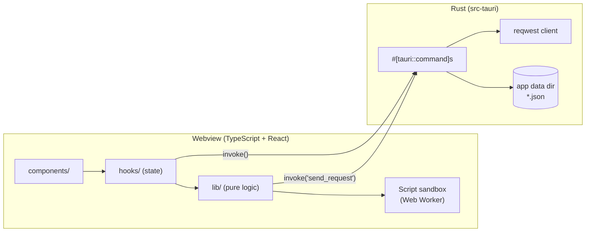
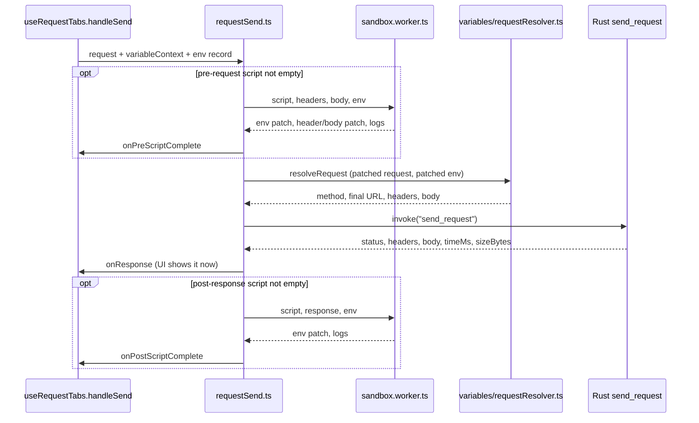

# Architecture

How cURLyQ is put together — the request flow, where state lives, and the
rules that are easy to break. Written for contributors and coding agents;
user-facing docs live elsewhere (README, `docs/scripting.md`).

This file describes *structure and intent*. It points at files rather than
restating their code — when the two disagree, the code wins and this file
needs fixing.

## Big picture

- **Rust does I/O only**: HTTP (`reqwest`) and reading/writing files. It has
  no business logic — no variable substitution, no scripts, no Postman
  mapping.
- **`src/lib/`** is plain TypeScript with no React — data transforms,
  the send pipeline, the variable engine, Postman import/export. Most logic
  changes belong here.
- **`src/hooks/`** owns app state (one hook per domain) and persistence.
- **`src/components/`** is UI. shadcn/ui primitives live in
  `components/ui/`; conventions in `.claude/skills/curlyq-ui/SKILL.md`.
- **`src/App.tsx`** wires the domain hooks together (see "State" below).

## Sending a request

The whole pipeline is `sendRequestWithScripts` in `src/lib/requestSend.ts`.
Both a tab's Send button and a collection run call it, so behavior can't
drift between the two.

What `resolveRequest` adds on the way out (`src/lib/variables/requestResolver.ts`):
`{{var}}` substitution in URL, params, header values and body; params merged
into the query string; `//` comments stripped from the body;
`Content-Type: application/json` if there's a body and no Content-Type;
`DEFAULT_HEADERS` (`User-Agent`, `src/lib/http.ts`) unless the user set it.
The cURL preview in the Variables panel calls the same function, so the
preview is exactly what gets sent.

On the Rust side (`send_request` in `src-tauri/src/lib.rs`): one shared
`reqwest::Client` with a 30s timeout; connect/timeout errors get a
plain-language headline before the technical message; response headers are
a `Vec<(String, String)>` so repeated headers (`Set-Cookie`) survive. A
binary Content-Type (`is_binary_content_type`: images, PDF, archives…) comes
back as `isBinary: true` with an empty `body` and only its size; everything
else is decoded with `.text()`, which honors the response charset.

## Variable engine (`src/lib/variables/`)

| File | Role |
|---|---|
| `tokenizer.ts` | `VARIABLE_PATTERN` — `{{name}}`, where name allows `\w`, `.`, `-` |
| `context.ts` | `VariableLookup` interface; scopes merged first-match-wins. Only one scope (the active environment) exists today |
| `resolver.ts` | Recursive resolution with cycle detection (`MAX_RESOLUTION_DEPTH = 10`). Returns `resolved` / `unresolved` / `circular` |
| `requestResolver.ts` | Turns a whole request into what goes over the wire (see above) |
| `diagnostics.ts` | Finds unresolved names for the UI |

Unresolved or circular tokens are sent **as the literal `{{name}}`**, not
removed. The editors color tokens by the same three states
(`components/codemirror/variableDecorations.ts`, `VariableAwareInput.tsx`).

Everything that resolves variables takes a `VariableLookup`, never an
`Environment` directly. That's what lets `withEnvironmentPatch` put a
script's fresh `ctx.environment.set()` values in front of the stored
environment without waiting for a React re-render.

## Scripts

Run in a Web Worker (`src/lib/scripting/sandbox.worker.ts`) with a 5s
timeout (`runScript.ts`). User-facing API and behavior: `docs/scripting.md`.
Key points for changing it:

- Only plain data crosses into the Worker (`postMessage`), so the
  environment is flattened to a `Record` first (`environmentToRecord`).
- Every side effect (`set`, `console.log`) is posted the moment it happens,
  so a script that times out keeps what it did before hanging.
- `pm` is the same object as `ctx`. A new `ctx` method is automatically a
  `pm` method — keep names Postman-compatible where Postman has an
  equivalent.
- The Worker is a crash/hang boundary, **not a security boundary** — it
  still has `fetch`. See `.tasks/plan.md` → Security.

## State and persistence

`App.tsx` composes four domain hooks:

| Hook | Owns | Saved to |
|---|---|---|
| `useEnvironments` | environments, active environment, `variableContext` | `environments.json` |
| `useRequestTabs` | open tabs, active tab, send state | `tabs.json` |
| `useCollections` | collection tree CRUD, drag-and-drop, import/export | `collections.json` |
| `useCollectionRun` | running a collection/folder | — (results open as a tab) |

`collections` state itself lives in `App.tsx`, not in `useCollections`,
because tabs and collections depend on each other: tabs write back into
collections (save, rename), and deleting from a collection closes tabs.

- JSON files are in Tauri's app data dir, written by generic
  `save_json`/`load_json` in `lib.rs`. A missing file loads as empty.
- Each hook saves with a **500 ms debounce** after state changes.
- UI preferences (theme, collapsed sections) use `localStorage` via
  `usePersistedState`, not the JSON files.

### Tabs vs. saved requests

A tab opened from a collection keeps `sourceRequestId`/`sourceCollectionId`.
Name and method sync to the collection live; URL, params, headers, body and
scripts are written back **only on explicit Save**. `isRequestTabDirty`
drives the unsaved-changes marker. **A collection run executes the saved
version, not what's in the open tab.**

### Collection run

`runCollectionRequests` (`src/lib/collectionRun.ts`) sends requests one by
one, in tree order, and keeps going after a failure. `ctx.environment.set()`
calls from earlier steps are collected in `accumulatedPatch` and layered on
top for later steps. "Pass" means a 2xx response — there's no assertion API
yet.

## Postman import/export

| | Code | Notes |
|---|---|---|
| Collections | `parsePostmanCollection` / `buildPostmanCollection` in `lib/collections.ts` | v2.1. Export writes `event`/`exec` scripts with a `ctx` → `pm` rewrite and a parsed `url` object (Postman's UI needs `host`/`path`/`query`, not just `raw`). Import drops scripts and non-raw bodies |
| Environments | `parsePostmanEnvironment` / `buildPostmanEnvironment` in `lib/environments.ts` | |
| Shared | `lib/postman.ts` | `PostmanImportError`, `dedupeName` ("Dev (2)") |

Files are read and written through the `read_text_file`/`write_text_file`
commands, with a path from the native file dialog. Results go to the
import/export log (`lib/importExportLog.ts`) and a toast.

## Rust ↔ TypeScript contract

Data types are defined twice: as serde structs in `src-tauri/src/lib.rs` and
as TS types in `src/lib/`. They must match by hand — nothing checks this at
compile time.

- Use camelCase on the wire. Structs use `#[serde(rename_all = "camelCase")]`;
  fields inside `CollectionNode` enum variants need an explicit
  `#[serde(rename = "...")]`, because `rename_all` on the enum only renames
  the `type` tag. A mismatch doesn't error — the field silently resets.
- Every field added to a persisted struct needs `#[serde(default)]`, or
  files saved by older versions stop loading.
- The `collection_node_tests` in `lib.rs` guard the serialization shape —
  extend them when changing `CollectionNode`.

Commands: `send_request`, `save_tabs`/`load_tabs`,
`save_environments`/`load_environments`,
`save_collections`/`load_collections`, `read_text_file`/`write_text_file`.

## Where to make a change

| Change | Start in |
|---|---|
| What gets sent (headers, URL building, body rules) | `lib/variables/requestResolver.ts`, `lib/requestUrl.ts` |
| Send order / script wiring | `lib/requestSend.ts` |
| New script API | `lib/scripting/sandbox.worker.ts` + `types.ts`, then `docs/scripting.md` |
| New persisted field on a request | `lib.rs` struct (with `serde(default)`), TS type, `toPersistedTab`/`fromPersistedTab` in `lib/requestTabs.ts`, Postman mapping if it has an equivalent |
| Collection tree operations | `lib/collections.ts` (pure), `hooks/useCollections.ts` |
| New Tauri command | `lib.rs` (register it in `invoke_handler`), and `capabilities/default.json` if it needs a plugin permission |

## Checks

CI (`.github/workflows/ci.yml`) runs `npm run build` (includes `tsc`),
`cargo fmt --check`, `cargo clippy -D warnings`, `cargo test`, and a per-OS
`cargo check`. There are no frontend tests.
